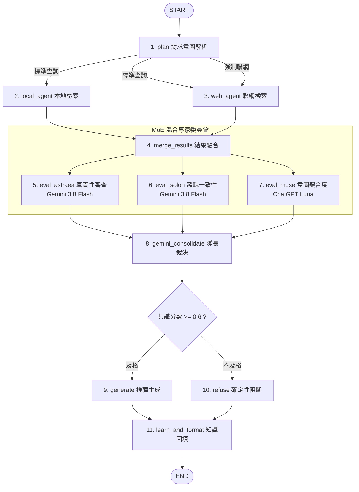

# 🌸 Project Shiori · 進化型輕小說 RAG 推薦系統

[](https://www.python.org/)
[](https://github.com/langchain-ai/langgraph)
[](https://ai.google.dev/)
[](https://www.docker.com/)
[](#)

> **Project Shiori** 是一套具備「自主演化學習能力」與「混合專家評審（MoE）防幻覺機制」的輕小說 RAG 智能推薦系統。  
> 透過 **LangGraph 11 節點狀態機**，將模糊需求轉化為多路並行檢索，並經由異質多模型委員會打分裁決，確保推薦品質；新發現作品則自動萃取並回填知識庫，實現終身學習。

---

## 📑 目錄

- [一、專案亮點與核心特色](#一專案亮點與核心特色)
- [二、系統架構與狀態機流轉](#二系統架構與狀態機流轉)
- [三、快速開始與本機部署](#三快速開始與本機部署)
  - [3.1 事前準備（API Key）](#31-事前準備api-key)
  - [3.2 方式 A：Docker Compose 一鍵部署（推薦）](#32-方式-adocker-compose-一鍵部署推薦)
  - [3.3 方式 B：本機 Python 虛擬環境手動部署](#33-方式-b本機-python-虛擬環境手動部署)
- [四、專案檔案結構](#四專案檔案結構)
- [五、二次開發指南](#五二次開發指南)
  - [5.1 狀態機規格 (`RAGState`)](#51-狀態機規格-ragstate)
  - [5.2 擴充或自訂 LangGraph 節點](#52-擴充或自訂-langgraph-節點)
  - [5.3 調整 MoE 評審規則與阻斷門檻](#53-調整-moe-評審規則與阻斷門檻)
  - [5.4 知識庫結構與書名清洗器](#54-知識庫結構與書名清洗器)
  - [5.5 執行自動化基準評測 (Benchmark)](#55-執行自動化基準評測-benchmark)
- [六、常見問題與疑難排解 (FAQ)](#六常見問題與疑難排解-faq)

---

## 一、專案亮點與核心特色

傳統輕小說檢索經常面臨**讀者情境記憶模糊**、**靜態資料庫不及時**以及 **LLM 推薦幻覺**三大痛點。Project Shiori 提出對應架構：

1. **🧠 自主演化學習迴圈 (Self-Evolution Loop)**：
   - 當本地知識庫無法滿足查詢時，系統自動發動 Brave Search 聯網檢索。
   - LLM 自動萃取新小說標題與概要，經過「強固型書名清洗器」標準化後，**即時回填 SQLite 與 Chroma 向量庫**。下次相同或相似查詢即可由本地秒級召回。
2. **🛡️ MoE 混合專家評審委員會 (防幻覺阻斷)**：
   - 檢索結果進入由 3 位專職評審（Astraea 真實性審查、Solon 邏輯一致性、Muse 使用者意圖吻合）組成的委員會並行打分。
   - 引入 **OpenRouter (ChatGPT Luna)** 作為異質模型，防止單一模型架構帶來的盲點。
   - 隊長 Gemini 3.8 Flash 計算加權共識分，**及格門檻 `>= 0.6` 始得進入生成節點**；低於門檻則走確定性拒絕路徑，物理層面杜絕瞎掰與幻覺。
3. **⚡ 硬性逾時保護與長尾延遲壓制**：
   - 全局採用 `ThreadPoolExecutor` 與 `invoke_with_timeout` 機制，為 Plan、檢索與各評審節點設置嚴格超時上限（10~25s），徹底根除底層 API Socket 卡死異常。
4. **☁️ 純雲端極速架構**：
   - 向量檢索採用 Google Cloud `gemini-embedding-001`，無需本機配置高階 GPU 顯卡即可高速運行。

---

## 二、系統架構與狀態機流轉

系統核心為基於 **LangGraph** 構建的 11 節點非循環狀態機（DAG）：



---

## 三、快速開始與本機部署

### 3.1 事前準備（API Key）

本專案運行需準備以下 3 組外部 API Key：

| 服務 | 說明 | 申請管道 |
|------|------|----------|
| **Google Gemini API** | 核心推理 (`gemini-3.8-flash`) 與向量嵌入 (`gemini-embedding-001`) | [Google AI Studio](https://aistudio.google.com/) |
| **Brave Search API** | 即時網路搜尋引擎（每月享免費搜尋額度） | [Brave Search API](https://brave.com/search/api/) |
| **OpenRouter API** | 異質評審模型 (`openai/gpt-6-luna`) | [OpenRouter](https://openrouter.ai/) |

請在專案根目錄建立 `.env` 檔案（可由範本複製）：
```bash
cp .env.example .env
```
並填入您的 Key：
```env
GOOGLE_API_KEY=AIzaSy...
BRAVESEARCH_KEY=BSAp...
openroute_KEY=sk-or-v1-...
```

---

### 3.2 方式 A：Docker Compose 一鍵部署（推薦）

專案已內建完整的 Dockerfile 與 docker-compose.yml，資料夾目錄會自動以 Volume 掛載至 `./data`，重啟容器資料不遺失。

1. **啟動容器**：
   ```bash
   docker-compose up --build -d
   ```
2. **查看日誌**：
   ```bash
   docker-compose logs -f
   ```
3. **存取 Web UI**：
   開啟瀏覽器造訪 [http://localhost:7860](http://localhost:7860) 即可開始使用 Gradio 對話與資料庫管理介面。
4. **停止容器**：
   ```bash
   docker-compose down
   ```

---

### 3.3 方式 B：本機 Python 虛擬環境手動部署

適合需要除錯或進行二次開發的開發者：

1. **確認環境**：需要 Python 3.12+。
2. **建立並啟用虛擬環境**：
   ```bash
   python3 -m venv .venv
   source .venv/bin/activate  # macOS / Linux
   # 或 .venv\Scripts\activate  # Windows
   ```
3. **安裝相依套件**：
   ```bash
   pip install --upgrade pip
   pip install -r requirements.txt
   ```
4. **啟動主程式**：
   ```bash
   python main_graph.py
   ```
5. **存取介面**：
   啟動後終端機將提示 `Running on local URL: http://0.0.0.0:7860`，直接開啟即可。

---

## 四、專案檔案結構

```
Project_Shiori/
├── main_graph.py          # ⭐️ v2 生產核心：11 節點 LangGraph 狀態機與 Gradio Web UI
├── main.py                # v1 線性 Pipeline（舊版，供演進對照參考）
├── benchmark_rag.py       # 📊 基準評測工具（20 組標準 Query 量化評估 Harness）
├── benchmark_results/     # 歷次評測結果（包含 P50/P95 延遲、Token 與 Markdown 報告）
├── data/                  # 本地持久化資料目錄（由 Docker 掛載）
│   ├── .gitkeep
│   ├── db/                # SQLite 資料庫（儲存小說中繼資料與學習歷程）
│   └── chroma/            # Chroma 向量資料庫（gemini-embedding-001 索引）
├── Dockerfile             # 容器構建檔 (Python 3.12-slim)
├── docker-compose.yml     # 容器編排檔 (端口 7860 / 掛載 ./data)
├── requirements.txt       # Python 套件清單 (LangGraph, Gradio, ChromaDB 等)
├── .env.example           # 環境變數範本檔
├── .gitignore             # Git 忽略配置（防止 API Key、快取與資料庫外洩）
├── AGENTS.md              # Agent 開發規範與自動測試指引
├── TODO.md                # 架構優化與待辦里程碑清單
└── 工作實績報告_進化型輕小說RAG推薦系統.md # 完整工程實績與架構調優白皮書
```

---

## 五、二次開發指南

### 5.1 狀態機規格 (`RAGState`)

所有節點透過繼承 `TypedDict` 的 `RAGState` 進行資料交換，關鍵欄位如下：

```python
class RAGState(TypedDict):
    # [輸入層]
    user_input: str               # 使用者原始輸入需求
    chat_history: List[List[str]] # 歷程記錄
    force_web_search: bool        # 是否略過本地直衝聯網
    
    # [規劃層]
    plan: Optional[Dict[str, Any]]# 含 normalized_query, book_title_candidates, web_query
    
    # [檢索層]
    local_context: str            # 本地 SQLite + Chroma 檢索結果
    web_context: str              # Brave Search API 檢索結果
    context_str: str              # 融合後的綜整上下文
    
    # [評審層 (MoE)]
    eval_astraea_score: float     # 真實性審查分數 (0.0 ~ 1.0)
    eval_solon_score: float       # 邏輯一致性分數 (0.0 ~ 1.0)
    eval_muse_score: float        # 使用者意圖吻合度 (0.0 ~ 1.0)
    final_consensus_score: float  # 隊長裁決加權總分
    
    # [產出層]
    bot_msg: str                  # 最終呈現在前端之回應
    recommendations: List[Dict]   # 萃取出的推薦書籍物件列表
```

---

### 5.2 擴充或自訂 LangGraph 節點

若需要新增新的節點（例如加入新的社群書評 Agent 或情感過濾節點）：

1. **在 `LangGraphRAG` 類別內實作節點方法**：
   ```python
   def my_custom_node(self, state: RAGState) -> Dict[str, Any]:
       # 讀取現有狀態
       query = state["user_input"]
       # 執行自訂邏輯...
       return {"custom_data": "result"}
   ```
2. **在 `_build_graph` 中註冊並連接邊線**：
   ```python
   builder.add_node("custom_node", self.my_custom_node)
   builder.add_edge("merge_results", "custom_node")
   ```

---

### 5.3 調整 MoE 評審規則與阻斷門檻

- **共識門檻值 (`CONSENSUS_THRESHOLD`)**：
  在 `main_graph.py` 第 32 行：
  ```python
  CONSENSUS_THRESHOLD = 0.6  # 低於此值將觸發 refuse 節點，確定性阻斷
  ```
- **自訂評審權重**：
  在 `_node_gemini_consolidate` 節點中調整加權公式（預設為隊長權衡三位專家觀點並產出 0.0~1.0 共識分）。

---

### 5.4 知識庫結構與書名清洗器

- **書名正規化 (`normalize_book_title`)**：
  為了杜絕 `GATE 奇幻自衛隊` 被錯誤截斷為 `GATE`、或是 `《無職轉生》(文庫版) 第1卷` 產生重複條目，系統實作了強固型清洗函式：
  - 自動剝除前綴標籤 (`【輕小說】`)、外層書名號 (`《...》`)
  - 清理末尾集數 (`第01卷`、`Vol.1`) 與版本詞 (`文庫版`、`完全版`)
  - **嚴格保護詞間空白**，確保中英混雜標題不被切碎。
- **SQLite 結構**：
  資料表 `light_novels` 包含欄位：`id`, `title`, `description`, `source` (`Native` 原生或 `Learned` 學習), `timestamp`。

---

### 5.5 執行自動化基準評測 (Benchmark)

本專案內建端對端基準評測腳本 `benchmark_rag.py`，內含 20 組標準 Query（精確書名 5 題、語意模糊 5 題、長尾冷門 3 題、應拒絕題 5 題、邊界極端題 2 題）：

```bash
# 執行完整評測套件
python benchmark_rag.py
```
評測完成後會自動在 `benchmark_results/` 目錄輸出：
- 量化指標報告（P50 / P95 延遲、Token 消耗量、應拒絕阻斷率）。
- JSON 詳細呼叫記錄與 Markdown 總結圖表。

---

## 六、常見問題與疑難排解 (FAQ)

### Q1: 啟動時提示 `⚠️ 警告: 請在 .env 檔案中設定 GOOGLE_API_KEY...`？
- **排查**：請確認已將 `.env.example` 複製為 `.env`，且檔案中確實填入了有效的金鑰，並位於專案根目錄。在 Docker 環境下，請確保 `docker-compose.yml` 正確載入 `env_file: - .env`。

### Q2: 呼叫時偶發出現 `調用逾時（已超過硬性上限 xx 秒）`？
- **說明**：這是專案為了防止雲端 API 底層連線或 Socket 無限卡死而設計的跨平台硬性超時保護（`invoke_with_timeout`）。遇到偶發網路波動時系統會優雅降級，可直接重試或檢查目前對外網路通暢度。

### Q3: 本地資料庫與學習紀錄如何備份或重置？
- 所有持久化資料皆集中於 `data/` 目錄：
  - 若需重置系統至全新狀態：清空 `data/db/` 與 `data/chroma/` 即可。
  - 若需備份資料：直接複製整個 `data/` 目錄。

### Q4: 如何在無外網環境（離線模式）運行？
- 系統支援純本地知識庫推薦模式。若關閉「強制聯網」且本地已有足夠資料，系統會優先透過本機 SQLite 雙向包含檢索與 ChromaDB 進行離線向量比對；但由於使用 Gemini 與 OpenRouter 雲端推論，仍需具備基本 API 外網連線能力。

---

## 📜 授權協議 (License)

本專案遵循 MIT License 協議開源。歡迎自由 Fork、提交 PR 或作為輕小說推薦系統二開基底！
